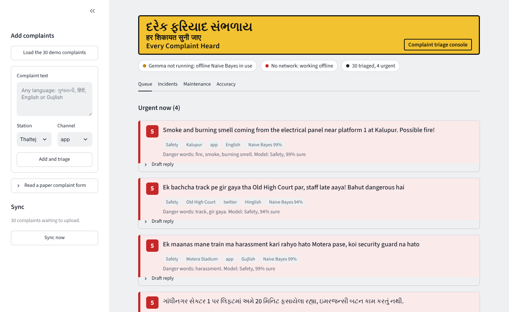
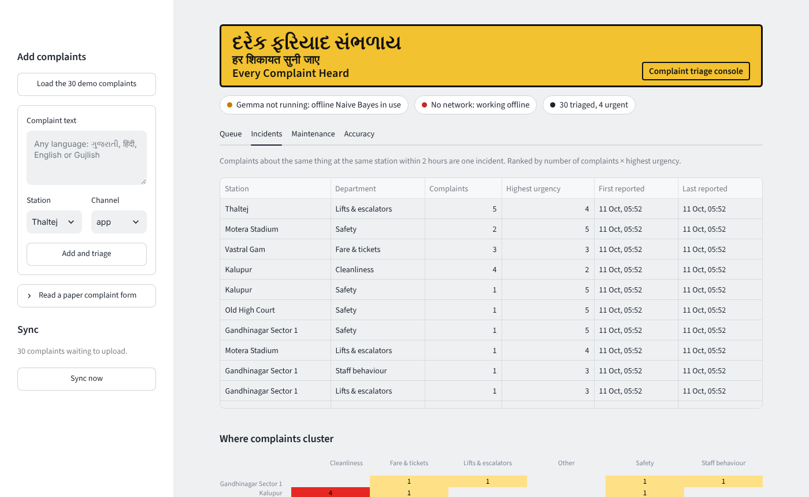
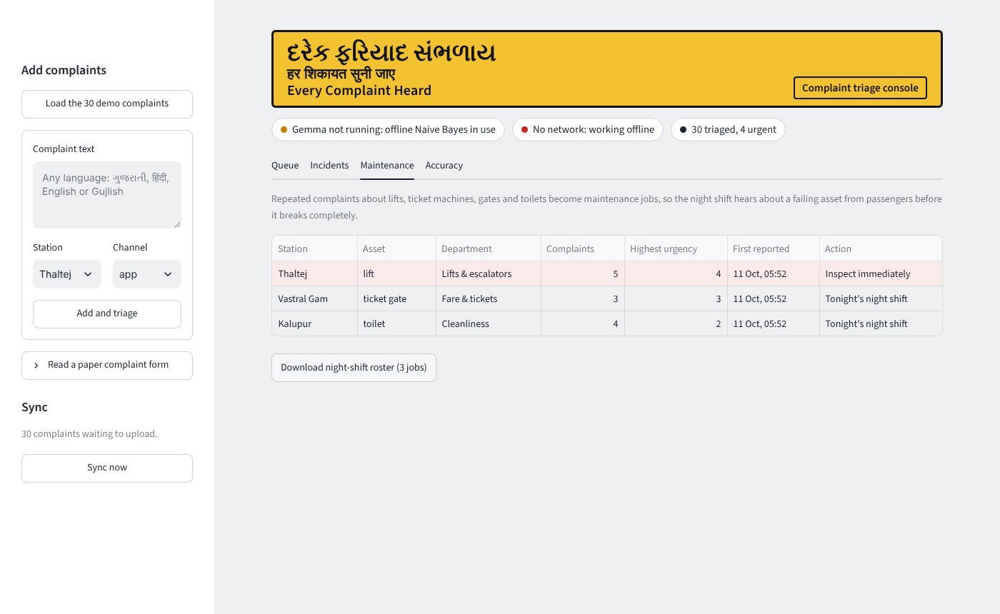
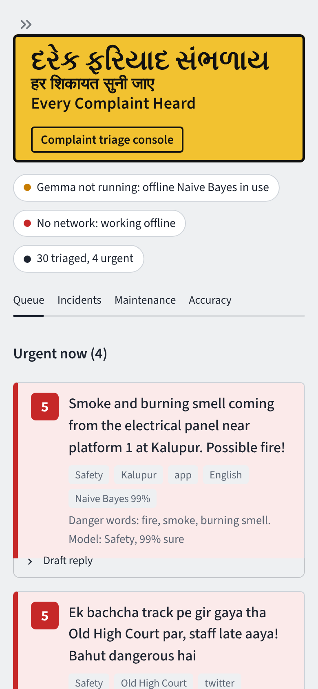
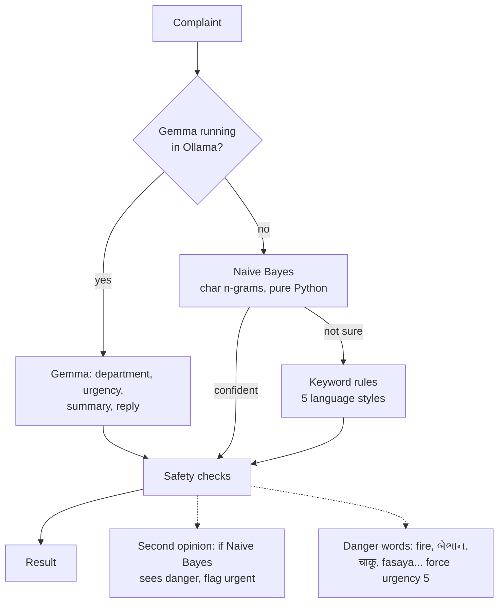

# Every Complaint Heard

**Offline complaint triage for metro station controllers.** It reads passenger complaints in Gujarati, Hindi, English, Gujlish and Hinglish, sends each one to the right department, puts danger to people at the top, and drafts a reply in the passenger's own language. It runs entirely on a laptop with no internet.

Built at **DevFest Gandhinagar Metro Hacks** (a 2-hour hackathon held on board the Gujarat Metro), problem statement PS-07, then refined afterwards with a proper test set and evaluation.



## The problem

Metro complaints arrive through the app, social media, email and paper forms, in several languages and scripts. Someone sorts them by hand, which takes hours, so a person stuck in a lift waits in the same pile as a dirty toilet. Station controllers often work underground with no network, so cloud tools are not an option.

## What it does

- **Department and urgency.** Each complaint goes to safety, lifts & escalators, cleanliness, fare & tickets, staff behaviour or other, with an urgency from 1 to 5.
- **Urgent lane.** Anything that puts people in danger (urgency 5) is pulled to the top, whatever department it belongs to.
- **Replies in the passenger's language.** A Gujlish complaint gets a Gujlish reply, a Hindi one gets Devanagari.
- **Incidents.** Five complaints about the same lift in two hours are one incident, not five tickets. A heatmap shows which stations and departments are struggling.
- **Maintenance jobs.** Repeated complaints about lifts, ticket machines and toilets become a prioritised night-shift roster (CSV), so maintenance hears about a failing asset from passengers before it breaks completely.
- **Offline sync.** Everything is stored locally in SQLite and uploaded when the network returns (outbox pattern).
- **Paper forms.** Photograph a handwritten form and a vision model transcribes it (needs `gemma3:4b`).

| Incidents | Maintenance | Phone |
|---|---|---|
|  |  |  |

## How it works

Three layers, each a fallback for the one above, followed by two safety checks that can only raise urgency, never lower it.



**Why Naive Bayes on character n-grams?** Gujlish has no fixed spelling ("che", "chhe", "6e"), and the same complaint arrives in three scripts. Character 2–4-grams handle both without a tokenizer per language. The model is about 60 lines of standard-library Python, trains in under a second and needs no install, which matters on a locked-down station laptop.

**Calibrated confidence.** Naive Bayes treats overlapping n-grams as independent, so its raw confidence is close to 100% even when it is wrong. Dividing the log-scores by √(number of features) fixes that: predictions above 90% confidence are right about 100% of the time on the test set, and those below 70% only about a third. Low-confidence results fall back to keyword rules or are marked "Check this one".

**Safety first.** Missing an emergency is far worse than an extra alert, so urgency 5 is raised if *any* layer sees danger, rather than by majority vote.

## Results

Measured on [`eval_complaints.json`](eval_complaints.json): 120 hand-written complaints (20 per department, in all five language styles) that are never used for training. Reproduce with `python tools/evaluate.py`.

| Layer | Department correct | Urgency within ±1 | Urgent cases caught | False urgent alerts | Time per complaint |
|---|---|---|---|---|---|
| Naive Bayes + rules (offline pipeline) | **92%** | **96%** | **92%** (12/13) | 3 | 1 ms |
| Keyword rules only | 68% | 91% | 92% | 1 | <1 ms |
| scikit-learn logistic regression (reference only) | 91% | | | | |

Department accuracy by language (offline pipeline): English 86%, Gujarati 96%, Gujlish 95%, Hindi 100%, Hinglish 89%.

**The honest version of these numbers:**

- The test set, training data and keywords were all written by the same author, so real complaints will be harder. The test set uses different sentences and phrasing from the training data, and a check in `test_app.py` makes sure no sentence appears in both.
- The model never saw the test set, but two thresholds and the danger-word list were set after looking at its mistakes, so the safety recall figure is slightly optimistic.
- At the hackathon the keyword rules scored 100% on the 30 demo complaints they were written against. On the new test set they score 68%. That gap is why the evaluation was rebuilt.
- The one urgent complaint still missed is a lost child described in Gujlish ("Bachchu bheed ma khovai gayu"). It was deliberately not patched with a keyword just to pass the test.
- Gemma has not been benchmarked yet. Run `python tools/evaluate.py` with Ollama running to add its row.

## Run it

```bash
pip install streamlit requests pandas altair
python -m streamlit run app.py
```

Click **Load the 30 demo complaints**, then **Triage**. Everything works offline.

Optional, to add Gemma (better summaries and free-text replies) and photo reading:

```bash
# install Ollama from https://ollama.com, then:
ollama pull gemma3:4b      # vision-capable, reads photos of paper forms
ollama pull gemma3:1b      # smaller and faster, text only
```

The app picks the best installed Gemma automatically. To force one, set `METRO_LLM=gemma3:1b`.

Other commands:

```bash
python test_app.py                       # 30+ checks, prints PASS/FAIL
python tools/evaluate.py                 # accuracy report -> results/scorecard.md
python tools/generate_training_data.py   # rebuild the training data (deterministic)
```

## Project structure

```
app.py                         Streamlit console
triage.py                      Gemma -> Naive Bayes -> rules, safety checks, reply templates
db.py                          SQLite store, incidents, maintenance roster, offline sync
sample_complaints.json         30 demo complaints
eval_complaints.json           120 hand-written test complaints (never trained on)
training_data.json             generated training set (see tools/)
tools/generate_training_data.py
tools/evaluate.py
test_app.py
```

## Who would run it

A metro operator could pilot this through a public-private partnership: a technology partner builds and maintains it and is paid a per-station licence, while complaint data stays on the operator's own devices. The incident and maintenance views give the operator something it does not have today: early warning about failing assets, sourced from passengers.

## Limitations and next steps

- Replies from the offline path are templates. Gemma writes free-text replies, but small models should have a human approve them before sending.
- Incident grouping uses fixed rules (same station, same department, within 2 hours).
- Next: benchmark Gemma on the test set, collect real (anonymised) complaints for training and evaluation, and connect sync to a real complaint-management API.

## Tech

Python, Streamlit, SQLite, pandas, Altair, Ollama with Gemma 3. The Naive Bayes classifier uses only the Python standard library.

Built by [Samay Rathod](https://github.com/SamayRathod265).
